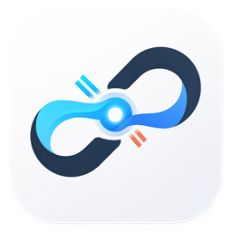

  
  <h1>Termous</h1>
  
<strong>An SSH workstation for connections, files, remote desktops, and AI</strong>

  

    <a href="./README.md">简体中文</a>
    ·
    <a href="https://github.com/Countra/termous/releases">Download</a>
    ·
    <a href="./docs/CHANGELOG.md">Changelog</a>
    ·
    <a href="https://github.com/Countra/termous/issues">Issues</a>
  

  

    
    
    
  

Termous brings SSH terminals, RDP / VNC remote desktops, multi-protocol file management, server operations, and an AI assistant into one desktop application. Hosts, connection profiles, and tasks stay connected as you work across servers and access methods.

Core features run locally without a cloud account. Configuration sync and device-to-device remote control are optional, and MCP connects external AI tools to authorized operations.

## Use cases

| Scenario | How Termous helps |
| --- | --- |
| Development and server maintenance | Keep hosts, terminals, file directories, snippets, and port forwarding in one workstation |
| Working across multiple hosts | Split sessions, send commands through the session command console, and inspect each session's output and results |
| Graphical remote tasks | Connect over RDP / VNC, exchange files when needed, and turn repetitive actions into automation workflows |
| AI-assisted troubleshooting | Share connections, terminal selections, or images with the assistant, then inspect and act within granted permissions and approvals |
| Working across devices | Optionally sync connection configuration or access resources explicitly authorized on another trusted device |

## Quick start

1. Download the installer for your platform from [Releases](https://github.com/Countra/termous/releases).
2. Add a host and the SSH, file, or remote desktop profiles you need. Each host can have multiple profiles.
3. Use Connect in the top bar or `+` in the session bar. The workstation, file manager, and remote desktop open their corresponding connection choices.
4. For AI, add a provider and model under Settings → Model providers, then choose the default model under Settings → AI assistant. Associate connections from session menus or send selected terminal text.
5. For cloud sync or remote control, sign in, authorize your device, and confirm the sync scope or remote access permissions.

A host organizes connection profiles and does not require an SSH connection. You can add only an RDP desktop or an independent object-storage profile. File operations, desktop authentication options, and system integrations depend on the selected protocol, configuration, and platform.

Configure third-party MCPs, Skills, and web search under Settings → Extensions, and choose enabled MCPs and Skills for each conversation. Open Product tour from the Help menu for an introduction or a feature tour.

## Features

### Hosts and connection profiles

Organize access methods around each host without duplicating its asset information for terminals, files, and desktops.

- Groups, tags, favorites, custom icons, and multiple profiles help distinguish environments and purposes.
- Profiles reference separately managed credentials. SSH supports passwords, private keys and passphrases, jump hosts, and HTTP / SOCKS5 proxies.
- Centralized SSH host-key confirmation and connection keepalive, with protocol-specific authentication and access options for files and desktops.
- The top-bar connection action follows the current workspace. Session-bar `+` menus offer matching profiles, search, and details on hover.

### SSH workstation

- Session tabs and split terminals, with pinning, renaming, color labels, duplication, and search for work across multiple hosts.
- Directory following between the terminal and SFTP reduces repeated navigation when switching to file management.
- Send commands to the current, selected, or all connected sessions through the command console. Inspect separate output, exit codes where available, and interruption state.
- Manage snippets, command completion, and Bash / Zsh / Fish aliases, with alias synchronization across hosts.
- Optional natural-language AI command suggestions are off by default. Suggestions are inserted into the input area for you to review and execute.

### Remote desktops

RDP and VNC use sessions independent of terminals and files, with direct or SSH-tunneled connections as needed.

- Full screen, display scaling, session menus, and connection quality and status information.
- Retained RDP sessions, resumed viewing, and separate viewing and control modes let you continue an existing connection after leaving the page.
- Manage default quality and per-session settings, adjust resolution, frame rate, and bitrate within actual capabilities, and inspect direct / relay paths and applied settings.
- Desktop tools provide file exchange and automation. The file sidebar remembers its latest tab, and the transfer indicator opens progress directly.
- Control-state and pointer indicators show when a desktop is being operated. Local users can reclaim input control.

AI, MCP, automation, and remote control can also access the host desktop with permission. Screens support observation and control; windows support observation only. Linux requires X11. Windows installers include a desktop management service, with separately authorized access to lock-screen / UAC secure desktops. Input pauses during a desktop switch and resumes only after the new view is confirmed and the original authorization remains valid.

### Desktop automation

Save repetitive graphical operations as workflows for repeatable desktop tasks and visual regression checks.

- Visually compose pointer actions, keystrokes, text input, image matching, conditions, and loops, with parameters for reuse.
- Use OCR to read, wait for, assert, or branch on text, and locate click and drag targets.
- Select coordinates or create image templates from a desktop screenshot. Zoom, pan, move and resize selections, and undo or redo selection edits.
- Analyze screens locally with region detection, OCR, or both. Inspect annotations, query text, manage records, and export results.
- Validate and save workflow versions before running, then pause, resume, step through, or cancel execution to investigate problems.
- Inspect per-step inputs, results, screenshots, and image templates in run history, with controls to expand or collapse all details.
- Import and export ZIP, JSON, or configuration directories with template images, including import previews, workflow updates, and historical-version exports. Importing does not execute a workflow.
- Edit and inspect runs in a separate window, with an entry to the target desktop. Display zoom does not change saved coordinates.

### Files and local mounts

File protocols share browsing, editing, previews, and transfers, with operations enabled according to storage capabilities.

- SFTP, S3 / MinIO, WebDAV, FTP / FTPS, and SMB. SFTP uses an associated SSH profile; other protocols can have independent access configuration.
- Text editing, image previews, bookmarks, and directory-size calculation. Linux file-name search can use an optional remote component.
- Cross-connection copies, distribution to multiple targets, and batch rename with previews reduce repetitive transfers and organization work.
- Centralized progress, results, and failure details, plus drag-and-drop uploads. Windows also supports system file copy and paste and RDP file clipboard integration.
- Mount file profiles as local drives or directories, with read-only access, automatic startup, synchronization, reconnection, and unmounting.
- Persistent mount caching downloads content on demand, with configurable capacity and reserved disk space. It reuses downloaded content without providing offline access.

Mounts require separately installed WinFsp on Windows, FUSE3 on Linux, or macFUSE on macOS. The application provides environment checks and status information.

### Server operations and networking

- Linux resource monitoring and processes, alongside systemd services, scheduled tasks for the current user, and iptables / nftables firewalls.
- Docker resources organized into containers, images, volumes, and networks, with search, details, common start and stop actions, logs, and container terminals.
- Image-tag management, creation and deletion of volumes and bridge networks, and container network attachment and detachment.
- Local and remote port forwarding and dynamic proxies, with saved profiles, automatic connection on Core startup, status, traffic, and failure details.

### AI assistant

The assistant works with actual connection resources to explain output, investigate problems, manage files, and perform authorized maintenance tasks.

- Custom model services and model selection, with text, image attachments, terminal selections, and references to SSH, files, desktops, and automation workflows.
- Concurrent conversations, queued messages, reordering, editing of pending messages, and task cancellation. SSH commands use coordinated execution queues.
- Context compaction, searchable history, groups, pinned and archived conversations, and model usage. Open the assistant in a separate window and return it to the main interface.
- Read local files in segments, make targeted edits, and review paginated diffs. Run local commands in the background, inspect output, and cancel tasks. A conversation's working directory resolves relative paths; it is not an operating-system sandbox.
- Execute short sequences of desktop pointer and keyboard actions with per-step results, background queries, and cancellation. Query the original task after a lost response without replaying dispatched input.
- Tool activity retains progress, results, and approval information so you can review commands, target resources, and operation scope before granting access.

### Extensions and search

- Add or import third-party MCPs using local commands, HTTP, or OAuth sign-in, and choose which sources a conversation can use.
- Recognized single-package npx configurations support managed installation and automatic initialization after first approval. Upgrades validate a candidate before replacing the current version. Changing the installation root affects new installations only.
- Import third-party Skills with a fixed version for each assistant run and an editable resource copy prepared when read. Scripts use the local command tool and still require approval; importing or reading a Skill does not execute scripts or install dependencies.
- Choose Termous cloud service or a self-hosted SearXNG instance for web links and snippets. Cloud search requires sign-in and server-side availability.
- The network proxy under Settings → Connection applies to MCP installation, connections, related OAuth, and local command environments for new tasks and connections. Web search uses direct connections.

### External AI clients

- External AI tools use authorized capabilities through MCP, with permissions and approval policies managed per client. Installing skills does not grant access.
- Bundled [Termous Skills](https://github.com/Countra/termous-skills) cover connections, files, server operations, desktops, and automation. Install them from MCP settings for Codex, Claude Code, or a custom directory.

MCP service exposes Termous tools to external clients, separately from importing third-party extensions into the built-in assistant. Local file, command, and web search tools are available only to the built-in assistant.

### Device-to-device remote control

Continue working with resources shared by another Termous device without copying all of that device's connection configuration to the controller.

- Access authorized terminals, files, RDP / VNC desktops, and the host desktop between trusted devices on the same account, switching workspaces in a separate remote window.
- Choose Full control or Custom access on the host device. Remote access is off by default, existing granular permissions are preserved, and local files remain limited to authorized directories.
- Use the host device's AI assistant according to its access policy, model configuration, and tool permissions. Conversations become available when the host assistant is ready.
- Desktop viewing and input control are separate. Local users can reclaim input control and inspect connection and transfer status.

### Cloud account and configuration sync

- Optional account and QR sign-in, profile management, two-factor authentication, and trusted devices, alongside local features that need no account.
- Preview and confirm differences between local and cloud configuration when first enabling sync. Subsequent changes can sync automatically within the confirmed scope. Signing in or authorizing a device does not automatically upload local configuration.
- End-to-end encrypted configuration, with personal recovery keys, approval from another trusted device, and optional managed cloud recovery.
- Uses the official cloud service by default, with support for another compatible service. Remote file contents, AI conversations, and machine-local settings are outside configuration sync.

See [Cloud accounts and sync](./docs/cloud-account.md) for details.

### Notifications, auditing, and desktop experience

- A message center for task results, pending approvals, and cloud account notices, with navigation back to relevant tasks.
- System notifications follow your preferences when no Termous window has focus. Switching between the main window and child windows does not trigger them.
- Local auditing for AI, MCP, and manual remote-control operations, with filters, search, approvals, task results, and related events. Ordinary local manual operations are not collected automatically.
- Settings open in a dialog that preserves your workspace. Pages requiring explicit saving use a consistent page-level save action and protect unsaved changes.
- Light and dark themes, configurable shortcuts, Chinese and English UI, tray support, in-app updates, and startup progress and module status.
- Encrypted `.tobp` configuration backups with full or selective restore. Exit checks for unsynchronized mount changes help protect pending writes.

## Security and privacy

- Credentials use protected local storage. SSH host-key checks, MCP permissions, and operation approvals govern access.
- AI conversations, selected attachments, and relevant tool results are sent to your configured model service. Conversation history is stored locally.
- Search queries reach the selected search service and search engines, outside end-to-end encrypted configuration sync. Third-party MCPs process call parameters according to their configuration.
- Cloud sync is independent of local features and backups. Optional managed cloud recovery gives the service the ability to recover data keys; enable it according to your needs.
- Remote access follows the host device's permissions. Operation records may contain commands or paths; review sensitive content before sharing them.

## Platforms

| Platform | Packages |
| --- | --- |
| Windows x64 | `.exe` |
| macOS ARM64 | `.dmg`, `.zip` |
| Linux x64 | `.AppImage` |

Windows is the primary platform, with macOS and Linux support continuing to improve. Some system integrations depend on the platform and runtime environment.

## Documentation and feedback

- [Changelog](./docs/CHANGELOG.md)
- [Frontend architecture](./docs/frontend-architecture.md) · [AI runtime](./docs/electron-agent-architecture.md) · [Desktop automation](./docs/remote-desktop-workflows.md)
- [Local files and tasks](./docs/local-files-and-runtime-wait.md) · [Product tour](./docs/product-tour.md) · [Settings](./docs/settings-center.md)
- [GitHub Issues](https://github.com/Countra/termous/issues)

Source development uses a separate Termous Dev shell that can run alongside an installed release. See [Desktop environments](./docs/desktop-environments.md) for startup, Core data directories, and notification isolation.
