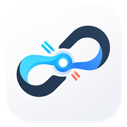

  
  <h1>Termous</h1>
  
<strong>集连接、文件、远程桌面与 AI 于一体的 SSH 工作站</strong>

  

    <a href="./README.en.md">English</a>
    ·
    <a href="https://github.com/Countra/termous/releases">下载</a>
    ·
    <a href="./docs/CHANGELOG.md">更新日志</a>
    ·
    <a href="https://github.com/Countra/termous/issues">反馈问题</a>
  

  

    
    
    
  

Termous 面向开发者与运维人员，将 SSH 终端、RDP／VNC 远程桌面、多协议文件管理、服务器运维和 AI 助手集中到一个桌面应用。主机、连接配置与任务相互关联，方便在多台服务器和不同访问方式之间切换。

核心功能在本机运行，无需登录云账号。按需启用配置同步和设备间远控，也可通过 MCP 与外部 AI 工具协作。

## 适用场景

| 场景 | 可以怎样使用 |
| --- | --- |
| 日常开发与服务器维护 | 将常用主机、终端、文件目录、代码片段和端口转发放在同一个工作站中 |
| 多主机操作 | 分屏查看不同会话，通过会话命令台发送命令，并分别查看输出与执行结果 |
| 图形化远程操作 | 使用 RDP／VNC 连接桌面，在需要时交换文件，或将重复操作编排成自动化流程 |
| AI 辅助排查 | 把连接、终端选区或图片交给助手，在权限与审批范围内查询状态、执行操作并核对结果 |
| 多设备协作 | 按需同步连接配置，或从另一台可信设备访问被控端明确开放的资源 |

## 快速开始

1. 从 [Releases](https://github.com/Countra/termous/releases) 下载对应平台的安装包。
2. 在“主机”中添加主机，并配置所需的 SSH、文件或远程桌面连接。同一主机可保存多套配置。
3. 点击顶部“连接”或会话栏的 `+` 开始使用；在工作站、文件和远程桌面中会打开对应类型的连接入口。
4. 使用 AI 助手前，在“设置 → 模型服务”添加服务和模型，再在“设置 → AI 助手”选择默认模型。可从会话菜单关联连接，或发送终端选区。
5. 如需云同步或设备间远控，登录账号后按页面指引完成设备授权，并确认同步范围或远控访问权限。

主机是连接配置的组织入口，不要求必须配置 SSH。例如，可以只添加一个 RDP 桌面，或为对象存储建立独立文件配置。文件协议的可用操作、远程桌面的认证方式及系统集成功能，会随具体配置和平台而有所不同。

## 功能概览

### 主机与连接配置

围绕主机集中组织访问方式，避免为同一台服务器的终端、文件和桌面重复维护资产信息。

- 支持分组、标签、收藏、自定义图标和多套连接配置，方便区分环境与使用目的。
- 凭据独立管理并由连接引用；SSH 支持密码、私钥及私钥口令，以及跳板机和 HTTP／SOCKS5 代理。
- SSH 主机指纹统一确认，连接配置支持保活；文件与桌面连接按各自协议管理认证和访问选项。
- 顶部连接入口跟随当前功能页，会话栏 `+` 提供对应类型的快捷配置列表，支持搜索及悬停查看详情。

### SSH 工作站

- 多会话标签与分屏，支持固定、重命名、颜色标记、复制会话和终端搜索，便于同时处理多台主机。
- 终端与 SFTP 目录跟随，减少在命令行和文件管理之间反复定位路径的操作。
- 会话命令台可面向当前、选中或全部已连接会话发送命令，分别查看输出、可获取的退出码及中断状态。
- 代码片段、命令补全和 Bash／Zsh／Fish 别名管理，可将常用别名同步到多台主机。
- 可选 AI 自然语言命令建议默认关闭；建议先插入输入区，由用户决定是否执行。

### 远程桌面

RDP 和 VNC 与终端、文件采用独立会话管理，可按连接需求直连或使用 SSH 隧道。

- 支持全屏与画面缩放，通过会话菜单管理连接，并查看连接质量和状态。
- RDP 支持保留会话、恢复观看以及观看与控制切换，临时离开页面后可继续使用已有连接。
- 桌面工具集中提供文件交换与自动化入口；文件侧栏保留最近访问的标签，传输状态入口可直接查看进度。
- 桌面接管期间提供控制状态与指针提示，本机用户可收回输入控制权。

### 桌面自动化

将重复的图形界面操作保存为流程，适合固定步骤的桌面任务与可视化回归检查。

- 可视化编排鼠标、键盘、文本输入、图像定位、条件和循环，配合参数复用同一流程。
- 从桌面截图选点或创建图像模板，支持缩放、平移、选区移动与边缘调整，以及选区操作的撤销和重做。
- 校验、保存流程版本后运行，提供暂停、继续、单步和取消操作，便于逐步定位执行问题。
- 执行记录按步骤展示输入、结果、截图及图像模板等证据，可统一展开或折叠详情。
- 支持独立窗口编辑和查看执行记录，并可跳转到执行目标桌面；截图的显示缩放不会改变配置坐标。

### 文件管理与本机挂载

不同文件协议共用浏览、编辑、预览和传输体验，具体操作按存储能力开放。

- 支持 SFTP、S3／MinIO、WebDAV、FTP／FTPS 和 SMB。SFTP 使用关联 SSH 配置，其他协议可独立配置访问方式。
- 支持文本编辑、图片预览、目录书签和目录大小计算；Linux 文件名搜索可按需使用远端组件。
- 跨连接复制、向多个目标分发和带预览的批量重命名，减少重复传输与整理操作。
- 集中查看任务进度、结果与失败原因；支持拖放上传，Windows 另提供系统文件复制粘贴和 RDP 文件剪贴板集成。
- 文件配置可挂载为本机盘符或目录，支持只读访问、自动启动、同步、重连与卸载。
- 挂载采用按需下载的持久化缓存，可设置容量与预留空间；缓存用于复用文件内容，不提供离线访问。

挂载功能在 Windows、Linux、macOS 分别需要 WinFsp、FUSE3、macFUSE。驱动需单独安装，应用提供环境检查及状态提示。

### 服务器运维与网络工具

- Linux 资源监控与进程列表，配合 systemd 服务、当前用户定时任务和 iptables／nftables 防火墙管理。
- Docker 按容器、镜像、数据卷和网络组织资源，支持搜索、详情、常用启停操作、日志查看和进入容器终端。
- 支持镜像标签管理、数据卷及桥接网络的创建与删除，以及容器网络的连接与断开。
- 本地、远程端口转发及动态代理，可保存配置、随 Core 启动自动连接，并查看运行状态、流量和失败原因。

### AI 助手与 MCP

助手与实际连接资源协作，可用于解释输出、排查故障、管理文件和执行已授权的运维任务。

- 接入自定义模型服务并选择模型，支持文本、图片附件、终端选区，以及 SSH、文件、桌面和自动化流程引用。
- 多个会话可并发运行，支持消息排队、调整顺序、编辑待发内容和停止任务；SSH 命令通过队列协调执行。
- 支持上下文整理、历史搜索、分组、固定与归档，显示模型用量；助手可在独立窗口中使用并返回主界面。
- 工具调用保留过程、结果与审批信息，用户可核对命令、目标资源和操作范围，再决定是否授权。
- 外部 AI 工具通过 MCP 使用已授权的能力，按客户端分别管理权限和审批策略；安装技能不等于获得访问权限。
- 内置 [Termous Skills](https://github.com/Countra/termous-skills)，覆盖连接、文件、运维、桌面和自动化；MCP 设置可为 Codex、Claude Code 或自定义目录安装配套技能。

### 设备间远控

从另一台设备继续使用 Termous 中已开放的资源，无需将被控端的全部连接配置复制到控制端。

- 在同账号可信设备间访问已授权的终端、文件和 RDP／VNC 桌面，在独立远控窗口中切换工作区。
- 被控端按主机连接、文件目录和桌面能力设置范围；本机目录需明确开放，远控默认关闭。
- 可单独允许远程使用被控端 AI 助手，沿用其模型配置与工具权限；被控端就绪后才开放实际对话。
- 桌面观看与输入控制分开处理，本机用户可收回输入控制权，并查看连接与传输状态。

### 云账号与配置同步

- 可选账号登录与扫码登录，支持个人资料、双重验证和可信设备管理，不影响无需账号的本机功能。
- 首次启用同步时预览本地与云端配置差异，确认后再应用；后续可按已确认范围自动同步，登录或授权设备不会自动上传本地配置。
- 配置采用端到端加密，支持个人恢复密钥、其他可信设备批准及可选的云端托管恢复。
- 默认使用官方云服务，也可配置其他兼容服务。远程文件正文、AI 会话和本机设置不在配置同步范围内。

更多说明见 [云账号与同步](./docs/cloud-account.md)。

### 消息、审计与桌面体验

- 消息中心集中展示任务结果、待审批操作和云账号提醒，便于从通知返回相关任务。
- 当所有 Termous 窗口均未获得焦点时，按设置发送系统通知；主界面与子窗口之间切换不触发提醒。
- 审计中心可筛选、搜索 AI 与 MCP 操作，查看审批、任务结果和关联事件；记录保存在本机，不包含普通手动操作。
- 设置以弹层打开，保留当前工作区；需要保存的页面采用统一的页面内保存入口，并保护未保存修改。
- 明暗主题、自定义快捷键、中英文界面、托盘和应用内更新，配合启动进度及模块状态提示。
- 配置支持加密 `.tobp` 备份和完整或选择性恢复；退出前检查尚未同步的挂载修改，减少未提交写入的丢失风险。

## 安全与隐私

- 凭据在本机受保护存储；SSH 主机指纹、MCP 权限和操作审批共同约束访问。
- AI 对话、选用的附件和相关工具结果会发送给你配置的模型服务；AI 历史保存在本机。
- 云同步与本机功能、备份相互独立。可选的云端托管恢复会赋予服务端恢复数据密钥的能力，应按自身需求选择。
- 远控按被控端授权开放资源；操作记录可能包含命令或路径，分享前请检查其中的敏感内容。

## 平台支持

| 平台 | 安装包 |
| --- | --- |
| Windows x64 | `.exe` |
| macOS ARM64 | `.dmg`、`.zip` |
| Linux x64 | `.AppImage` |

Windows 是当前重点支持的平台，macOS 和 Linux 体验持续完善；部分系统集成功能受平台和运行环境限制。

## 文档与反馈

- [更新日志](./docs/CHANGELOG.md)
- [前端架构](./docs/frontend-architecture.md) · [AI 运行时](./docs/electron-agent-architecture.md) · [桌面自动化](./docs/remote-desktop-workflows.md)
- [GitHub Issues](https://github.com/Countra/termous/issues)

源码开发使用独立的 Termous Dev 应用壳，可与正式安装同时运行。启动方式、Core 数据目录与系统通知隔离见 [桌面环境](./docs/desktop-environments.md)。
