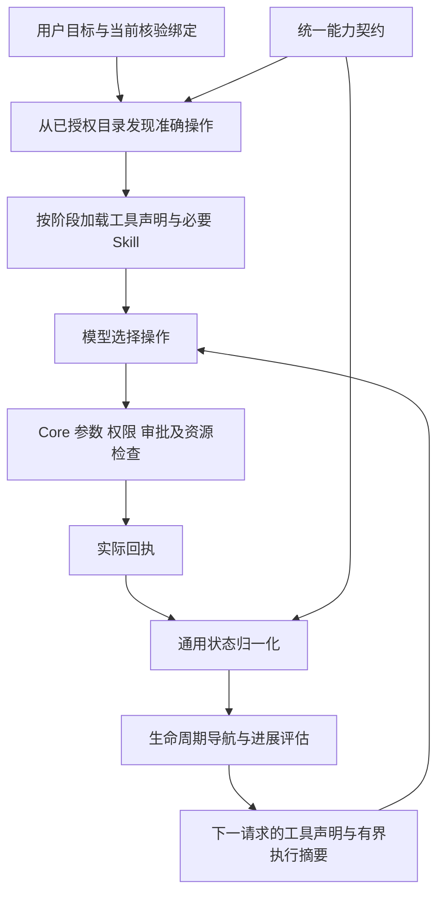

# Agent 统一能力契约与执行反馈

本次把桌面故障修复扩展为全部内置 MCP 能力共用的导航与进展机制。继续使用 pi Agent 1.2.0、Electron Worker 和 Core；模型负责选择操作，Core 负责真实权限、审批、资源身份和执行。声明式生命周期不替代用户目标，也不自动执行后续工具。

## 数据源与边界

`termous-skills/contracts/agent-capabilities.json` 是唯一维护源，覆盖 134 个 MCP 工具和本地 workflow 等待工具，按 29 个能力定义职责、检索动作、阶段、Skill URI、状态字段、后续入口和清理依赖。

`scripts/sync_capabilities.py` 生成两个只读副本：

- Core 的 `internal/api/mcp/toolkit/capabilities.generated.json`。
- Worker 的 `electron/agent/contracts/capabilities.generated.json`。

Skills 校验及桌面构建检查完整工具覆盖、唯一归属、真实文档和后续工具引用，并拒绝副本漂移。参数 Schema、权限及审批合同仍由 Core 原有注册器维护，不在导航契约中复制。新增工具必须补充能力契约，通常无需改运行时分支。

Core 的目录中间件在原有授权过滤之后补充说明与 `termous/capability` MCP 元数据；复制响应，避免并发目录查询累积说明或修改共享工具。内置和外部客户端看到相同的职责边界。未知工具保留原说明，Worker 只提供保守发现提示，不猜测生命周期。

## 通用执行链



阶段统一为发现、查询、观察、预览、提交、轮询、结果、变更、输入、取消和关闭。提交后查询、预览后确认、取消后核验终态等行为由共同引擎处理。领域状态差异用受限数据声明，例如 `transfer.status`、`operation.phase`、`report.run.state`。桌面附着 ready 等必要条件保留为字段与枚举规则，不把工具名判断写进主循环。规则不支持任意代码执行。

错误按权限/审批、版本冲突、能力缺失、参数前置条件、结果不确定等语义处理。只推荐当前获准目录中真实存在的候选，不自动执行、不绕过权限、不重放结果未知的写入。本地未派发门禁只能建议已登记的读取阶段；远端正文不能注入下一步工具。

## 发现与上下文效率

工具分组、Skill 映射和后续入口均来自契约，删除从 Skill 正文正则提取前八个工具的路径。按需读取完整 `skill://` 地址，仍按 URI、哈希和上下文存在性去重；本机启动 Skill 继续仅供具备本地执行能力的外部客户端使用。

发现接口优先使用结构化检索：`operation` 指明动作，`query` 描述资源，例如 `operation=read`、`query=已启动的 systemd 服务操作状态`。每个工具支持的动作来自契约，不能根据 `create`、`action` 等名称后缀猜测语义。合同校验要求全部工具声明有效动作；业务 MCP 的参数保持不变。

兼容的自由文本路径召回多个匹配动作，处理并列目标并排除明显的过去状态，不再以句中第一个动词硬选唯一操作。此路径是有界词法检索，不承诺理解任意自然语言；复杂目标应拆成明确的动作与资源，模型核对候选职责后选择。准确资源目标可以纠正错误的 group 提示，并明确返回 group_correction；权限目录不变。缺少资源限定时，最近明确选择的能力用于候选排序；明确的新目标优先。单次搜索预计算候选，不逐工具重复解析整条查询。

资源识别先于动作过滤：更具体的资源匹配排除仅匹配其泛化词的候选，再与动作取交集。例如请求删除 Docker 容器时，目录没有该能力就返回空候选，不能因镜像也包含 Docker 而推荐删除镜像。缺少资源匹配且没有明确分组或连续查询依据时返回目录提示。

继续限制每次发现最多 8 个工具、当前活动声明最多 32 个，并保留必要清理入口。每次模型请求只投影当前状态和阶段文档，容量估算包含实际声明和文档。既有 80% 压缩阈值、完整工具边界和检查点提交协议不变。

## 进展评估

### 调用前引导与桌面阶段

系统提示要求 Agent 在内部核对下一动作、完成证据、工具效果、参数和当前前置条件，不要求公开思考过程或逐次确认。准确操作缺失或职责不明时，先利用已有声明和历史线索，再通过 `discover_tools` 精确名称、动作与资源或能力组发现。历史名称不是本轮声明；候选加载不执行操作，也不替模型决定目标。

能力组浏览优先契约 `entry`，精确名称和明确资源/动作仍优先。无匹配时返回当前获准能力组与可用搜索示例。自动加载的后续候选和清理工具不改变能力偏好；偏好来自显式发现或成功使用的提交、变更、输入及预览。

桌面回执由 `runtimeDesktopObservation.ts` 解析规定结构，读取 `attachment`、`control.attachment` 和输入 `operation`。`evidence.approvals` 允许契约声明嵌套审批路径，Python 校验仅接受字段路径列表。只有 ready、非空 grant ID 且绝对/闲置期限均有效的回执才导航到常用键鼠输入与即时截图；等待、拒绝、缺少 grant 或过期不能描述为已可输入。

普通截图不自动加载 workflow 固定帧工具；目标需要模板或固定帧时显式发现对应能力。成功释放没有默认下一步申请，必要清理声明与已完成资源保护继续保留。Core 对同一观察入口重复申请返回 `desktop_control_already_held`，原请求幂等行为不变；其他占用仍返回原错误码。Worker 同时兼容旧 Core 的 `desktop_control_locked`，先查询当前附着，不预判占用归属，不自动接管。

### 本轮事实与历史恢复

`RuntimeToolProgress` 保留通用统计和现有清理保护；`RuntimeExecutionState` 管理事实、历史恢复与有界摘要，Runtime 仅装配模块。桌面事实分别记录附着、连接/执行代次、grant、期限、来源和观察时间。释放、明确失效、代次变化与关闭更新提示；旧 grant 回执不覆盖同一附着的新 grant。事实不成为执行权限，所有真实调用仍由 Core 核验。

checkpoint details 中的执行诊断升级为 `version: 2`，兼容读取 v1。新 Worker 恢复的事实和诊断均标为 `historical`，不继承重复计数或短期授权；原命令任务、工作流运行及结果标识继续保留供查询。当前运行内压缩只投影状态，内存中的事实和计数保持。原始持久消息不改写，摘要最多约 2,048 字符，检查点执行状态最多 48 KiB；摘要优先本轮事实及未解决问题，历史提示随后。完整反馈留在原回执中。

首次异常和 3/6/12 次重复提示继续生效；重复成功提交使用“重复取得相同前置状态或提交回执”。发现工具、换请求 ID 和其他资源查询不视为恢复；查询确认同一附着持有有效 grant 后，解除其重复申请诊断。没有新增普通工具拦截、隐藏、循环停止或默认执行预算。

首次恢复与重复诊断共用 `runtimeToolNavigation`：结构化错误类别、契约指定的空集合和当前可信目标绑定决定候选。能力契约的 `missing` 声明资源不存在时可用的核验入口；未声明时不回退到反复查询相同失效 ID。普通内部错误不推断为资源不存在，参数修正或环境变化仍允许重试原工具。

回执统一在 `observeToolResult` 观察并按调用 ID 去重。正常执行通过 `afterToolCall` 附加导航；准备参数、schema 校验及未加载工具的失败通过消息事件和完整轮结束补齐观察，诊断进入下一请求的执行摘要。发现模块只负责加载声明、检查可用性和容量，不在工具 execute 包装中重复解释结果。

首次异常及空集合诊断以有界当前状态保存，写入既有 checkpoint details；恢复时按当前目录过滤候选，不恢复资源授权。重复检测仍在第三次提示，不新增强制停止、隐藏工具或自动执行。桌面入口 Skill 明确加载 list/connect/get/attach/capture，精确 Session 不存在时仍要求用户恢复或替换绑定。

图像只比较有效图像、区域和代次；其他领域按契约排除采集时间等无效变化，保留业务 revision、状态、内容和实际进度。任务 ID、路径、进程与连接代次参与资源隔离，不把同会话的多个任务合并。

重复观察、重复失败和短周期循环继续第三次提示，按 3/6/12 退避；重复成功提交即使获得新任务 ID，也不能冒充推进同一请求。连续输入独立处理，普通重复不强制终止或隐藏工具。相同操作和资源的实际成功可恢复失败诊断，其他资源及无关查询不能清空诊断。

真实 pending 状态的轮询有 60 秒无进展宽限期；状态或进度变化重新计时并恢复原停滞提示，超过宽限后仍按重复规则提示继续核查原任务，不建议新建任务。长驻资源的就绪态通过 `evidence.settled` 声明：隧道的 `running` 表示已可使用；命令与传输的 `running` 仍待完成。审批和人工暂停等待单独识别；仅传 wait_ms 不能获得永久豁免。轮询计时不恢复历史授权，也不持久化为跨重启截止时间。

进展提示和从检查点恢复的候选入口均重新按当前可用目录过滤；权限收紧或输入安全门禁生效时，历史候选不能重新变为可执行入口。

## 审批执行冲突与重复提示修复（2026-10-16）

真实桌面记录中，4 次 `control.acquire` 对应 3 个审批：其中一次复用请求 ID，只回取原失败结果。前两次批准后因控制入口占用返回 `control.approval.state=dispatch_conflict`、`error_code=desktop_control_locked`，MCP 外层仍为成功信封；之后明确接管才取得有效 grant。原 Worker 漏判嵌套执行冲突，使占用导航未命中，附着查询和申请循环又分别发出诊断，授权成功后旧诊断没有恢复。

本次修复保持原审批合同、幂等、租约和执行权限：

- `runtimeToolOutcome` 按契约审批路径识别 `dispatch_conflict` 的领域错误，`dispatching` 视为等待；拒绝、过期、取消仍优先按审批边界处理。导航保留明确的失败态规则，避免把失败附着误作准备中或误入 ready 的成功导航。
- `piAgentAdapter` 用统一语义设置工具结果的 `isError`，模型回执、持久 `tool_result.is_error` 与时间线 `tool_failed` 一致。原 MCP 载荷与历史消息不改写。
- `runtimeDesktopObservation` 区分当前查询未返回授权的 `not_held` 和需重新核验的 `needs_verification`；两者都不表示应立即重新申请。历史恢复、代次变化和失效更新提示，真实权限仍由 Core 判断。
- `RuntimeToolProgress` 保留首次纠错和 3/6/12 提示节奏。仅合并紧随同一附着申请失败的那次成功前置查询警告，保留查询计数和往返检测；持续单独查询仍按原节奏提示。新确认有效 grant 后恢复该附着的申请和查询诊断，清除对应过时错误事实；其他资源、等待审批或没有有效 grant 的批准回执不能恢复。重复返回同一 grant 仍累计诊断。
- 契约及桌面 Skill 解释相同请求 ID 只取回原结果、换 ID 不能解除占用；查询核验后，可等待条件变化或按用户已有接管授权提交新申请。不增加普通调用拦截、强制停止、自动接管或默认预算。

验证结果：全量 Node 2,343 项（2,331 通过、12 跳过），相关 UI 23 项、Python 28 项通过。两种模型协议的集成测试直接检查下一请求的声明、摘要、时间线事件和持久结果；脱敏回放覆盖本次调用顺序、等待/过期/无 grant、相同 grant 重复、多资源和重启恢复。后端真实审批引擎的回归确认旧 ID 回取不重执行、参数变化触发幂等冲突、接管需新审批。

相关 Go race、合同副本同步、类型、变更文件 ESLint、样式及架构检查通过。Renderer、Electron、Preload 和 Skills 生产构建通过，Agent Worker 为 1,453,078 bytes，未提高体积预算。构建首次遇到开发预览期间的目录占用，关闭本次预览后重跑通过。

In-app Browser 使用实际组件检查失败展示、展开详情、诊断原位恢复及浅深色和中英文。这里只验证组件呈现，不代表真实模型已纠正或远端应用已执行。本次没有重新运行真实模型或操作远端桌面；后续需在新 Worker/Skills 生效后回归原任务，观察重复申请和首次有效输入，不能据确定性夹具保证模型绝不循环。日志及截图位于既有 `TEMP/agent-control-conflict-*`。

## 审批冲突修复复查（2026-10-16）

进一步检查执行保护、重复诊断和审计调用链，补充以下边界修复：

- 回执与审批字段的受限解析集中到 `contracts/runtimeToolResult.ts`，执行层与工具层共同使用；工具结果分类和桌面业务判断仍在工具层，不引入执行层对工具层的反向依赖。原有 JSON 内容块读取只保留一份实现。
- `RuntimeInputSafety` 识别申请回执中嵌套的 `desktop_cleanup_uncertain`，兼容旧 Core 的 `desktop_input_uncertain` 清理错误，沿用既有副作用保护；查询与正常回复继续。普通占用、等待或拒绝不会误触发保护。用户启用的执行预算使用相同审批错误分类，默认仍关闭。
- 前置查询去重只关联上一条同附着失败回执，不因历史恢复提示长期存在而吞掉持续查询警告；真实交替回放保持一条控制冲突诊断，单独持续查询仍在 3/6/12 次提示。
- `RuntimeAuditWriter` 保留拒绝、过期、取消、部分失败和不确定等既有审计终态；确需补失败时优先记录已归一化的领域错误码，并经过原审计投影过滤，不记录原始异常正文。

先用回归用例复现上述三类行为问题，再修复。最终全量 Node 2,351 项（2,339 通过、12 跳过、0 失败），包括 Responses 与 Chat Completions 的实际下一请求、事件、持久结果和审计集成验证。相关 Go race、Skills Python 28 项、合同同步、类型、变更文件 ESLint、样式及架构检查通过。全仓代码 lint 仍受未修改的 `scripts/ci/go-build-command.test.mjs` 中 4 条 `no-regex-spaces` 既有问题阻塞。

最终 Renderer、Electron、Preload 与 Skills 生产构建通过，Agent Worker 为 1,453,635 bytes，未调整体积预算。验证日志保存在既有 `TEMP/agent-control-review-*`。本次复查未改 UI 组件，也未重跑浏览器、真实模型或远端桌面；前节的 UI 记录属于上次验证，不能替代本次真实任务回归。部署新 Worker/Skills 后仍需观察原任务的申请次数、冲突恢复和首次有效输入。

## 回归范围

确定性测试覆盖完整工具合同、跨领域阶段导航、两种模型协议下一请求的实际声明、权限缺失、错误分类、多资源隔离、版本/时间变化、重复提交、正常输入和长轮询宽限。原始桌面故障的脱敏回放继续保留。

真实模型导航验收使用既有 Core 认证链、Electron utilityProcess Worker 和 glm-5.3-flash。`run-progress-acceptance.mjs --capabilities --keep-sessions` 创建五个独立会话，分别检查 SSH/片段、文件传输、systemd/Crontab、隧道、桌面/workflow。只发现工具，不执行远端业务操作。验收检查 request_usage 中的实际有效声明，不把可能截断的历史工具正文当作完整证据。

普通桌面故障仍使用同一脚本原有五项实际操作验收。两类验收每轮时间和请求上限只属于验收程序，不改变产品的提示并继续策略。有限验收不能保证任意模型或任意任务不再循环。

工具选择的合成模型验收使用 `scripts/agent/run-tool-guidance-acceptance.mjs`。通过开发 Core 现有 supervisor、ticket、bootstrap 链取得用户明确选择的模型；凭据仅留在内存。所有业务工具由本地状态夹具实现，不连接真实桌面。验收创建的会话、运行、执行槽和宿主在结束时清理。

运行前关闭其他 Agent Supervisor，并确保开发 Core 没有活动或排队任务；验收期间不要提交其他任务。脚本在注册及每次领取前检查权威工作区快照，发现其他任务即停止，领取身份异常也停止后续验收。现有领取接口面向全局队列，快照检查不能消除检查后新增任务的并发窗口，因此该脚本不能在共享调度环境运行。心跳串行发送，注销前等待在途心跳完成。

```powershell
node scripts/agent/run-tool-guidance-acceptance.mjs --model=glm-5.3-flash --repetitions=3
```

`--baseline` 可指定修改前导出 `createPiAgent` 的适配器 bundle，`--baseline-skill` 指定对应旧桌面 Skill；两者与当前版本使用同一模型和夹具。`first`、`history`、`compaction`、`discover` 分别检查首轮、错误历史、真实压缩后继续及未自动加载的剪贴板操作。压缩夹具使用既有手动压缩入口与可切分的合成历史，不写回用户设置、不改变模型窗口和执行预算。报告记录实际请求声明、发现参数、调用序列、有效输入前请求数、重复前置调用（相同工具与错误类别）和累计 Token，保存在既有 `TEMP/runtime/agent-guidance`。合成成功只证明工具选择行为，不代表远端应用操作成功。

本轮 Worker 增加回执归一化和历史状态投影，完整依赖闭包约 1.38 MiB；按既有 64 KiB 档位把构建体积预算从 1,408 KiB 更新为 1,472 KiB。没有增加依赖，Provider/依赖白名单与模块架构检查保持原约束。

## 工具跨轮引导验收记录（2026-10-16）

最终源码全量 Node 测试 2,316 项：2,304 通过、12 项按既有条件跳过、0 失败。Responses 和 Chat Completions 的 18 项集成用例检查实际下一请求中的工具声明与执行摘要，覆盖等待/拒绝审批、缺少/过期 grant、占用错误、历史恢复、释放和真实压缩；强制模型在警告后继续重复申请，确认普通工具仍可执行。

Skills 的 28 项 Python 测试、能力契约同步、TypeScript、修改文件 ESLint、样式和架构门禁通过。桌面控制、MCP 适配和后端架构的 Go race 检查通过，MCP API/服务包回归通过。正式生产构建及打包 Skills 校验通过，Agent Worker 完整产物 1,449,490 bytes，Terminal Completion Worker 455,684 bytes。全仓代码 lint 仍被未修改的 `scripts/ci/go-build-command.test.mjs` 中 4 处 `no-regex-spaces` 既有问题阻塞。

In-app Browser 实际渲染进展组件，检查诊断展开、长候选工具名换行、detected → progressed 更新、中英文和浅/深色；726px 宽度无页面横向溢出。此验证覆盖诊断显示，不代表真实远端桌面操作。

真实模型采用既有 `glm-5.3-flash`、low 推理配置和同一合成工具目录。下表每格包含三次独立运行；请求数计至首次有效输入，压缩场景也计入摘要请求，Token 为整次运行的累计用量均值（取整）。基线与最终版本均为 12/12 完成目标。

| 场景 | 基线首次输入请求数 | 最终版本首次输入请求数 | 基线平均 Token | 最终版本平均 Token |
| --- | --- | --- | ---: | ---: |
| 首轮 | 5 / 5 / 6 | 5 / 5 / 5 | 74,730 | 77,295 |
| acquire/release 错误历史 | 6 / 7 / 9 | 6 / 5 / 8 | 97,224 | 93,716 |
| 真实压缩后继续 | 7 / 10 / 7 | 7 / 8 / 8 | 388,249 | 390,197 |
| 未自动加载的剪贴板工具 | 9 / 6 / 4 | 5 / 7 / 7 | 77,145 | 72,102 |

最终版三次剪贴板场景均先发现不存在的名称，再根据无匹配回执改用能力组或动作搜索，实际获得并调用 `termous.desktops.clipboard.set_text`。一个错误历史样本先遇到 `desktop_not_found`，随后查询、附着、申请授权并完成输入，没有重复错误。两版本首次输入前的重复工具/同类错误代理计数均为 0；该计数不能等同于完整业务进展判定。有限样本尚未复现用户原有的持续循环，不能据此宣称循环率已下降、所有模型都能纠正或 Token 必然减少。

最初将合成窗口人为缩为 32,768 的六个压缩压力样本均未完成，分别触发既有 `AGENT_RUNTIME_CONTEXT_COMPRESSION_UNAVAILABLE` 或 `AGENT_RUNTIME_CONTEXT_COMPRESSION_INSUFFICIENT`。原始失败保留；未放宽产品保护。上表压缩验收使用原配置 262,144 窗口和既有手动压缩入口，六次均实际压缩一次并继续完成目标。

原始报告位于 `TEMP/runtime/agent-guidance/`：`report.json` 保留初次对照及压力失败；上表取其中非压缩场景的 baseline，与 `compaction-final.json` 的两版本压缩结果、`current-final.json` 的最终源码复验组合。报告保留每请求工具声明、发现参数、累计用量和调用序列；最终复验另记发现结果与工具失败。三个报告的 `cleanup_errors` 均为空，创建的验收会话、运行、执行槽与 supervisor 已清理。

## 工具跨轮引导复查记录（2026-10-16）

本次复查保留能力契约、Worker 事实投影与 Core 权限校验的分层。桌面结构解析集中在 `runtimeDesktopObservation.ts`，历史恢复和摘要集中在 `runtimeExecutionState.ts`；进展模块只协调诊断，不把桌面状态分支堆入 `piAgentAdapter`，也不新增执行门禁。

| 确认的问题 | 修复与边界 |
| --- | --- |
| 会话已失败、不存在或连接／执行代次变化，旧附着仍提示持有授权 | 根据同会话的实际回执更新为需重新核验；其他会话及旧代次关闭回执不影响当前授权 |
| 外层成功但嵌套审批被拒绝，纯状态投影仍可能表示有授权 | 归一化和事实观察共同复用语义结果，审批未完成或拒绝不投影为持有控制权 |
| 历史失败已被后续成功解决，恢复时仍保留旧经验；查询请求与回执的资源键不同也会留下诊断 | 实时与历史复用有范围的恢复确认；只消除同资源诊断及已确认恢复的空集合，等待状态不冒充完成 |
| 工具搜索先截取前八项再过滤安全状态，漏掉后续可用工具 | 先过滤，再按原声明容量安排前八项；授权及输入安全保护不变 |
| 新的已有授权错误缺少 HTTP 状态映射 | 保留明确错误码并返回 409，避免被当作存储错误 500 |
| 合成夹具查询隐式续租、错误身份也能取得成功回执 | 固定授权期限，核对会话、代次、附着与 grant；操作查询只返回已登记操作；成功要求准确输入及释放授权 |
| 验收心跳可能在注销后迟到注册，全局领取可能碰到其他任务 | 串行心跳并等待退出；领取前检查空闲 Core，资源身份或清理异常停止后续验收。并发隔离限制见运行说明 |

本轮全量 Node 共 2,332 项：2,320 通过、12 跳过、0 失败。Responses 与 Chat Completions 共 20 项集成用例检查真实请求声明及摘要，新增连接代次变化后的授权失效投影；夹具与验收资源管理另有 6 项确定性测试。Skills 的 28 项 Python 测试、合同同步、TypeScript、变更文件 ESLint、样式和架构检查通过。

桌面控制、MCP 桌面适配、桌面工作流 HTTP 及后端架构 Go race 检查通过，MCP API 和访问服务回归通过。Renderer / Electron / Preload 生产构建与 Skills 打包校验通过，Agent Worker 完整产物为 1,450,973 bytes，Terminal Completion Worker 为 455,684 bytes，本次复查没有再次调整体积预算。

全仓 lint 仍仅报告未修改的 `scripts/ci/go-build-command.test.mjs` 中 4 处 `no-regex-spaces` 问题。日志保存在既有 `TEMP/agent-guidance-review-*.log`。本轮没有启动开发 Core、操作开发数据或重新运行真实模型／远端桌面／UI；上节真实模型数据属于复查前夹具，不能用来证明修正后授权边界和释放终态的真实模型表现。

## 统一架构验收记录（2026-10-15）

### 首次失败恢复复验

- 最终源码的全量 Node 测试：2,247 项通过、12 项跳过；Python 合同测试 28 项通过。相关 MCP / 访问层 Go 测试、桌面错误与 SDK 接口并发检测通过。
- 类型检查、本次修改的 ESLint、样式检查、架构门禁及 Renderer / Electron Worker 构建通过。Worker 完整依赖闭包为 1,441,726 字节，未调整既有体积上限。全量 lint 仍被未修改的 `scripts/ci/go-build-command.test.mjs` 中 4 处 `no-regex-spaces` 问题阻塞。
- 使用现有 `glm-5.3-flash`、`low` 推理档位和 Electron Worker + Core，在 `VM-Debian12` VNC 与 `win测试` RDP 上完成五项验收：三个新会话、两个历史继续任务。五项恢复任务各使用 5 次模型请求；两个历史准备轮各使用 3 次，共 31 次请求。
- 五项均在首次明确的会话不存在回执后，下一次模型决策转向准确连接、工具发现或有效会话核验；失效 ID 重复调用均为 0。两个实际桌面会话均到达 `ready`，后续任务复用原 ID。
- 验收只检查连接与状态，不操作远程应用。未新建主机、Profile 或模型配置；本次测试会话、连接、Core 与 Electron 进程已清理。报告位于 `TEMP/runtime/agent-progress/recovery-report.json`，清理错误为空。

验收程序单独限制每轮 20 次请求和 180 秒，不改变产品执行预算。统计区分同轮已安排的正确核验与收到错误后的下一轮恢复；原始两轮报告保留供复查，最终结果以上述最终构建复验为准。有限样本不能保证模型永远不再重复。

### 此前统一架构验收

- 全量 Node：2,207 项通过、10 项跳过；Python 合同测试 28 项通过。
- 全部 MCP 后端测试、类型检查、lint、样式和架构门禁通过。
- Skills 合同校验通过：9 个 Skills、134 个工具、45 个权限；29 个能力完整覆盖，并检查检索动作及生成副本。
- Renderer、Electron Worker、Preload 构建通过；Worker 完整依赖闭包 1,425,272 字节，未提高本阶段已有的 1,441,792 字节上限或增加依赖。
- UI 与事件持久化未在本阶段改动；沿用第一阶段 2,620 项 UI 测试及 In-app Browser 实测记录。

资源匹配约束收紧前，跨领域真实模型导航五项全部通过，共 11 次请求（2/2/2/2/3），检查下一请求实际的 `effective_tools`。第五项首次误选 `preview` 查找普通截图，无匹配后重新查询并找到正确入口；系统没有把该动作替换为另一种实际操作。此阶段报告保留在 `TEMP/runtime/agent-progress/capability-before-resource-filter-report.json`。

同阶段桌面五项实际操作也全部通过，共七轮、55 次请求（7/8/11/6+9/6+8）。第三项实际出现重复提示，并取得固定快照及同帧局部放大的成功回执；两项历史继续任务均重新核验和附着后完成。报告位于 `TEMP/runtime/agent-progress/report.json`。最后的资源匹配收紧只改变搜索召回，确定性回归覆盖全部场景，最终构建另行重跑五项真实模型导航。

最终构建的五项真实导航复验全部通过，共 12 次请求（2/2/2/3/3），清理错误为空。最终报告与脱敏查询证据位于 `TEMP/runtime/agent-progress/capability-report.json`、`capability-evidence.json`。这些测试验证真实模型对跨领域工具目录的检索和后续声明加载；远端业务操作仅由合同、集成夹具及领域测试覆盖，不能将目录验收描述为全部远端操作实测。

此前三次导航验收失败报告分别保留为 `capability-initial-report.json`、`capability-second-report.json`、`capability-third-report.json`。这些失败暴露自由文本主动作误判、错组和截断回执导致的验收误判，不能计入通过样本。现在结构化动作与资源分离，兼容自由文本进行多候选召回；验收从实际请求诊断读取有效工具，不解析截断正文判成功。

## 未提交修改复查记录（2026-10-15）

复查覆盖 Worker 的能力发现、生命周期与进展判断、请求投影、压缩提交和恢复，以及 Core 的目录说明、事件归属、持久化和界面投影。保留现有 pi Agent / Worker / Core 分层，不新增框架、依赖或数据库迁移。领域差异继续放在能力契约中，没有按具体工具名扩展主循环。

| 确认的问题 | 修复与边界 |
| --- | --- |
| 临时执行摘要和阶段文档可能进入检查点保留尾部，重启后成为永久历史 | 分离纯历史投影与请求补充项。补充项计入容量但不参与压缩摘要及保留尾部；实际状态仍有界保存到 details |
| 图片变化标记用量失效后，后续复制消息可能绕过对象身份标记 | 在复制前清除失效 Provider 用量；下一有效请求重新校准 |
| 临时自动文档使显式 Skill 读取误判为已持久读取 | 显式读取去重只查询纯历史；能力切换后完整文档仍可保留 |
| 长驻隧道 running 被误判为等待结束 | 契约声明就绪枚举；命令和传输 running 仍属于执行中 |
| 停滞轮询恢复实际进度后，旧诊断仍保持 detected | 有效状态或进度变化时恢复同资源、同操作的诊断 |
| 旧检查点没有执行状态时，跳过了可用保留历史 | 只有成功恢复状态快照才跳过对应历史，否则回放保留回执；不恢复授权 |
| 当前或恢复后的提示候选可能包含不可用入口 | 按当前授权目录及已有安全门禁过滤候选，不扩大权限 |

新增回归检查实际模型请求、压缩摘要请求和提交载荷，覆盖临时补充项持久化隔离、旧检查点恢复、图片工作集变动，以及显式 Skill 读取后的跨能力切换。已删除的旧本地工具包装模块没有残留引用。

本轮实际执行结果：

- 全量 Node：2,213 项通过、10 项跳过。
- Python 合同测试：28 项通过；9 个 Skills、134 个工具、45 个权限及生成副本校验通过。Skill Markdown 和 YAML 中未检出中文。
- 后端 MCP、Agent model/service/view、SQLite 及 Agent HTTP controller 相关测试通过。
- Agent 进展提示、Inspector、页面、消息列表、工作区投影、压缩及重试投影共 7 个 UI 测试文件、158 项通过。
- TypeScript 类型检查、lint、样式检查、架构门禁和三仓库 diff 检查通过。
- Renderer、Electron Worker、Preload 构建通过；Agent Worker 完整依赖闭包为 1,428,202 字节，低于已有 1,441,792 字节上限。

本轮没有重新执行真实模型或 In-app Browser 验收，上节真实环境结果属于此前阶段。UI 测试中的 JSDOM 伪元素样式提示、构建中的较大分包提示不影响上述检查通过。验收日志位于既有 `TEMP/agent-review-*.log`；没有操作开发数据库，云服务和移动端原有配置改动保持原状。

## 首次失败恢复专项复查（2026-10-15）

本次复查覆盖未提交的 Core 错误映射、统一能力契约、Worker 回执观察、恢复导航、摘要及检查点恢复。继续使用既有分层和有界状态，不新增执行拦截、权限或模型请求。

| 复查确认的问题 | 修复与边界 |
| --- | --- |
| 参数准备失败和未加载工具虽然进入观察入口，仍被归为原因不明 | 根据 pi 实际经过的校验阶段分类；执行阶段的异常不能伪装成本地未派发回执。不解析异常文案来判断是否完成参数校验 |
| 列表由非空变为空时，结果变化处理误删刚生成的恢复诊断 | 诊断更新和进展计数独立；同一结果的变化不会删除当前异常说明 |
| 连接成功后，旧空列表诊断仍提示没有会话 | 沿用契约的 progresses 规则，只有真实成员 ID 回执能消除对应无筛选空列表。授权失败、单纯请求参数及其他领域回执不消除诊断；成员存在不等于连接就绪 |
| SSH 和文件列表省略空集合字段，导致规则无法命中；缺失结构化回执又可能被当作空列表 | 仅对已核实的列表序列化行为声明兼容；没有结构化回执不推断为空集合，不改变 SSH 和文件公共输出接口 |
| 重复诊断与首次诊断占用相同摘要内容，旧候选可能滞留 | 合并相同工具、资源和说明的诊断；每次摘要与检查点投影重新按当前可用目录过滤候选 |

清理了文件能力中无法命中的 Session 绑定规则和仅由内部导航使用的导出入口；补充合同校验，拒绝没有绑定来源的恢复目标和无效的集合进展引用。重复的通用恢复文案已精简，具体职责和安全限制继续保留。

本轮全量 Node 测试 2,255 项通过、12 项跳过；Python 合同测试 28 项通过。相关 MCP 与 mcpaccess Go 测试、桌面及 toolkit 并发检测、类型检查、本次变更 ESLint 和架构门禁通过。回归直接检查 Responses 与 Chat Completions 的下一请求和当前摘要，覆盖本地校验、未加载工具、执行异常、空列表变化、授权过滤和检查点恢复。

Renderer、Electron Worker 和 Preload 构建通过；Agent Worker 完整闭包 1,441,767 字节，未改变已有 1,441,792 字节上限或增加运行时依赖。

全量 lint 仍被未修改的 `scripts/ci/go-build-command.test.mjs` 中 4 处 `no-regex-spaces` 问题阻塞。日志位于 `TEMP/agent-recovery-review-*.log`；本轮未重跑真实模型、远程桌面或 UI 验收，前面的五次真实模型结果属于实施阶段。本轮没有创建测试配置或修改开发数据。

## 调用前引导与控制状态

`termous-skills/contracts/agent-capabilities.json` 的步骤可选字段 `preparation` 只描述调用前的选择依据，`guidance` 仍描述调用后的下一步。Core 为外部 MCP 的工具声明追加“调用前”，Worker 使用同一生成合同补充发现结果和活动工具声明，避免重复追加。该字段不自动查询、不改写参数、不注册执行门禁。

桌面 `get(attachment_id)` 在原有就绪和代次核验后，将当前协议快照投影为 `attachment.control`；不会输出其他入口的租约 ID、所有者或控制凭据。

| 状态 | 模型选择 |
| --- | --- |
| `held` | 当前 grant 有效时直接输入；缺失或过期时重新查询核验，不直接再次申请 |
| `available` | 目标需要输入时普通申请 |
| `takeover_required` | 已有明确接管授权时首次即可提交 takeover=true，否则先澄清影响 |
| `blocked` | 按 reason 处理观看归属、清理或授权变化；接管不能解决这些条件 |
| 字段缺失 | 旧 Core 或未完成核验，占用未知；不将缺失视为空闲，也不循环查询缺失字段 |

这些状态只反映查询瞬间，不预留控制权；实际申请仍由既有审批、权限、代次和租约校验决定。只观察无需申请控制，人工收回控制也不授权模型自动夺回。Worker 将状态与原因放进现有有界摘要，历史恢复、连接代次变化、执行端不可用、释放、授权过期或申请冲突时重新标记待核验；嵌套审批错误与顶层错误采用相同的诊断语义，普通调用仍由模型选择。

同一调用前说明机制用于 SSH 命令派发、文件传输和桌面输入，说明准确资源标识、已有查询的复用、参数来源与不确定结果的处理。测试覆盖 Core 状态脱敏、租约及清理边界、外部声明、两种模型协议的首次接管流程和旧 Core 兼容。模拟模型只验证信息传递和执行边界，不代表真实模型首次选参成功率。
