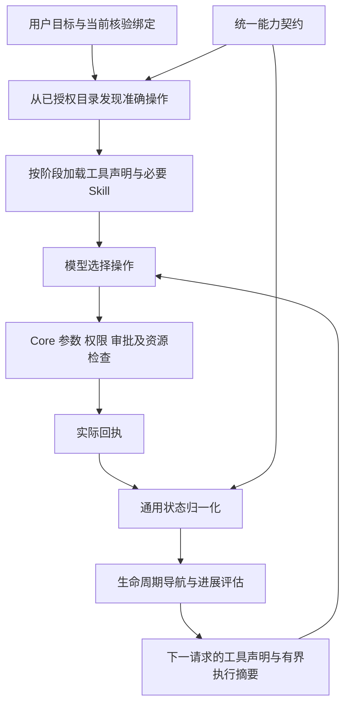

# Agent 统一能力契约与执行反馈

本次把桌面故障修复扩展为全部内置 MCP 能力共用的导航与进展机制。继续使用 pi Agent 1.2.0、Electron Worker 和 Core；模型负责选择操作，Core 负责真实权限、审批、资源身份和执行。声明式生命周期不替代用户目标，也不自动执行后续工具。

## 数据源与边界

`termous-skills/contracts/agent-capabilities.json` 是唯一维护源，覆盖 134 个 MCP 工具和本地 workflow 等待工具，按 29 个能力定义职责、检索动作、阶段、Skill URI、状态字段、后续入口和清理依赖。

`scripts/sync_capabilities.py` 生成两个只读副本：

- Core 的 `internal/api/mcp/toolkit/capabilities.generated.json`。
- Worker 的 `electron/agent/contracts/capabilities.generated.json`。

Skills 校验及桌面构建检查完整工具覆盖、唯一归属、真实文档和后续工具引用，并拒绝副本漂移。参数 Schema、权限及审批合同仍由 Core 原有注册器维护，不在导航契约中复制。新增工具必须补充能力契约，通常无需改运行时分支。

Core 的目录中间件在原有授权过滤之后补充说明与 `termous/capability` MCP 元数据；复制响应，避免并发目录查询累积说明或修改共享工具。内置和外部客户端看到相同的职责边界。未知工具保留原说明，Worker 只提供保守发现提示，不猜测生命周期。

## 通用执行链

阶段统一为发现、查询、观察、预览、提交、轮询、结果、变更、输入、取消和关闭。提交后查询、预览后确认、取消后核验终态等行为由共同引擎处理。领域状态差异用受限数据声明，例如 `transfer.status`、`operation.phase`、`report.run.state`。桌面附着 ready 等必要条件保留为字段与枚举规则，不把工具名判断写进主循环。规则不支持任意代码执行。

错误按权限/审批、版本冲突、能力缺失、参数前置条件、结果不确定等语义处理。只推荐当前获准目录中真实存在的候选，不自动执行、不绕过权限、不重放结果未知的写入。本地未派发门禁只能建议已登记的读取阶段；远端正文不能注入下一步工具。

## 发现与上下文效率

工具分组、Skill 映射和后续入口均来自契约，删除从 Skill 正文正则提取前八个工具的路径。按需读取完整 `skill://` 地址，仍按 URI、哈希和上下文存在性去重；本机启动 Skill 继续仅供具备本地执行能力的外部客户端使用。

发现接口优先使用结构化检索：`operation` 指明动作，`query` 描述资源，例如 `operation=read`、`query=已启动的 systemd 服务操作状态`。每个工具支持的动作来自契约，不能根据 `create`、`action` 等名称后缀猜测语义。合同校验要求全部工具声明有效动作；业务 MCP 的参数保持不变。

兼容的自由文本路径召回多个匹配动作，处理并列目标并排除明显的过去状态，不再以句中第一个动词硬选唯一操作。此路径是有界词法检索，不承诺理解任意自然语言；复杂目标应拆成明确的动作与资源，模型核对候选职责后选择。准确资源目标可以纠正错误的 group 提示，并明确返回 group_correction；权限目录不变。缺少资源限定时，最近明确选择的能力用于候选排序；明确的新目标优先。单次搜索预计算候选，不逐工具重复解析整条查询。

资源识别先于动作过滤：更具体的资源匹配排除仅匹配其泛化词的候选，再与动作取交集。例如请求删除 Docker 容器时，目录没有该能力就返回空候选，不能因镜像也包含 Docker 而推荐删除镜像。缺少资源匹配且没有明确分组或连续查询依据时返回目录提示。

继续限制每次发现最多 8 个工具、当前活动声明最多 32 个，并保留必要清理入口。每次模型请求只投影当前状态和阶段文档，容量估算包含实际声明和文档。既有 80% 压缩阈值、完整工具边界和检查点提交协议不变。

## 进展评估

图像只比较有效图像、区域和代次；其他领域按契约排除采集时间等无效变化，保留业务 revision、状态、内容和实际进度。任务 ID、路径、进程与连接代次参与资源隔离，不把同会话的多个任务合并。

重复观察、重复失败和短周期循环继续第三次提示，按 3/6/12 退避；重复成功提交即使获得新任务 ID，也不能冒充推进同一请求。连续输入独立处理，普通重复不强制终止或隐藏工具。相同操作和资源的实际成功可恢复失败诊断，其他资源及无关查询不能清空诊断。

真实 pending 状态的轮询有 60 秒无进展宽限期；状态或进度变化重新计时并恢复原停滞提示，超过宽限后仍按重复规则提示继续核查原任务，不建议新建任务。长驻资源的就绪态通过 `evidence.settled` 声明：隧道的 `running` 表示已可使用；命令与传输的 `running` 仍待完成。审批和人工暂停等待单独识别；仅传 wait_ms 不能获得永久豁免。轮询计时不恢复历史授权，也不持久化为跨重启截止时间。

进展提示和从检查点恢复的候选入口均重新按当前可用目录过滤；权限收紧或输入安全门禁生效时，历史候选不能重新变为可执行入口。

## 回归范围

确定性测试覆盖完整工具合同、跨领域阶段导航、两种模型协议下一请求的实际声明、权限缺失、错误分类、多资源隔离、版本/时间变化、重复提交、正常输入和长轮询宽限。原始桌面故障的脱敏回放继续保留。

真实模型导航验收使用既有 Core 认证链、Electron utilityProcess Worker 和 glm-5.3-flash。`run-progress-acceptance.mjs --capabilities --keep-sessions` 创建五个独立会话，分别检查 SSH/片段、文件传输、systemd/Crontab、隧道、桌面/workflow。只发现工具，不执行远端业务操作。验收检查 request_usage 中的实际有效声明，不把可能截断的历史工具正文当作完整证据。

普通桌面故障仍使用同一脚本原有五项实际操作验收。两类验收每轮时间和请求上限只属于验收程序，不改变产品的提示并继续策略。有限验收不能保证任意模型或任意任务不再循环。

## 统一架构验收记录（2026-10-15）

- 全量 Node：2,207 项通过、10 项跳过；Python 合同测试 28 项通过。
- 全部 MCP 后端测试、类型检查、lint、样式和架构门禁通过。
- Skills 合同校验通过：9 个 Skills、134 个工具、45 个权限；29 个能力完整覆盖，并检查检索动作及生成副本。
- Renderer、Electron Worker、Preload 构建通过；Worker 完整依赖闭包 1,425,272 字节，未提高本阶段已有的 1,441,792 字节上限或增加依赖。
- UI 与事件持久化未在本阶段改动；沿用第一阶段 2,620 项 UI 测试及 In-app Browser 实测记录。

资源匹配约束收紧前，跨领域真实模型导航五项全部通过，共 11 次请求（2/2/2/2/3），检查下一请求实际的 `effective_tools`。第五项首次误选 `preview` 查找普通截图，无匹配后重新查询并找到正确入口；系统没有把该动作替换为另一种实际操作。此阶段报告保留在 `TEMP/runtime/agent-progress/capability-before-resource-filter-report.json`。

同阶段桌面五项实际操作也全部通过，共七轮、55 次请求（7/8/11/6+9/6+8）。第三项实际出现重复提示，并取得固定快照及同帧局部放大的成功回执；两项历史继续任务均重新核验和附着后完成。报告位于 `TEMP/runtime/agent-progress/report.json`。最后的资源匹配收紧只改变搜索召回，确定性回归覆盖全部场景，最终构建另行重跑五项真实模型导航。

最终构建的五项真实导航复验全部通过，共 12 次请求（2/2/2/3/3），清理错误为空。最终报告与脱敏查询证据位于 `TEMP/runtime/agent-progress/capability-report.json`、`capability-evidence.json`。这些测试验证真实模型对跨领域工具目录的检索和后续声明加载；远端业务操作仅由合同、集成夹具及领域测试覆盖，不能将目录验收描述为全部远端操作实测。

此前三次导航验收失败报告分别保留为 `capability-initial-report.json`、`capability-second-report.json`、`capability-third-report.json`。这些失败暴露自由文本主动作误判、错组和截断回执导致的验收误判，不能计入通过样本。现在结构化动作与资源分离，兼容自由文本进行多候选召回；验收从实际请求诊断读取有效工具，不解析截断正文判成功。

## 未提交修改复查记录（2026-10-15）

复查覆盖 Worker 的能力发现、生命周期与进展判断、请求投影、压缩提交和恢复，以及 Core 的目录说明、事件归属、持久化和界面投影。保留现有 pi Agent / Worker / Core 分层，不新增框架、依赖或数据库迁移。领域差异继续放在能力契约中，没有按具体工具名扩展主循环。

| 确认的问题 | 修复与边界 |
| --- | --- |
| 临时执行摘要和阶段文档可能进入检查点保留尾部，重启后成为永久历史 | 分离纯历史投影与请求补充项。补充项计入容量但不参与压缩摘要及保留尾部；实际状态仍有界保存到 details |
| 图片变化标记用量失效后，后续复制消息可能绕过对象身份标记 | 在复制前清除失效 Provider 用量；下一有效请求重新校准 |
| 临时自动文档使显式 Skill 读取误判为已持久读取 | 显式读取去重只查询纯历史；能力切换后完整文档仍可保留 |
| 长驻隧道 running 被误判为等待结束 | 契约声明就绪枚举；命令和传输 running 仍属于执行中 |
| 停滞轮询恢复实际进度后，旧诊断仍保持 detected | 有效状态或进度变化时恢复同资源、同操作的诊断 |
| 旧检查点没有执行状态时，跳过了可用保留历史 | 只有成功恢复状态快照才跳过对应历史，否则回放保留回执；不恢复授权 |
| 当前或恢复后的提示候选可能包含不可用入口 | 按当前授权目录及已有安全门禁过滤候选，不扩大权限 |

新增回归检查实际模型请求、压缩摘要请求和提交载荷，覆盖临时补充项持久化隔离、旧检查点恢复、图片工作集变动，以及显式 Skill 读取后的跨能力切换。已删除的旧本地工具包装模块没有残留引用。

本轮实际执行结果：

- 全量 Node：2,213 项通过、10 项跳过。
- Python 合同测试：28 项通过；9 个 Skills、134 个工具、45 个权限及生成副本校验通过。Skill Markdown 和 YAML 中未检出中文。
- 后端 MCP、Agent model/service/view、SQLite 及 Agent HTTP controller 相关测试通过。
- Agent 进展提示、Inspector、页面、消息列表、工作区投影、压缩及重试投影共 7 个 UI 测试文件、158 项通过。
- TypeScript 类型检查、lint、样式检查、架构门禁和三仓库 diff 检查通过。
- Renderer、Electron Worker、Preload 构建通过；Agent Worker 完整依赖闭包为 1,428,202 字节，低于已有 1,441,792 字节上限。

本轮没有重新执行真实模型或 In-app Browser 验收，上节真实环境结果属于此前阶段。UI 测试中的 JSDOM 伪元素样式提示、构建中的较大分包提示不影响上述检查通过。验收日志位于既有 `TEMP/agent-review-*.log`；没有操作开发数据库，云服务和移动端原有配置改动保持原状。
